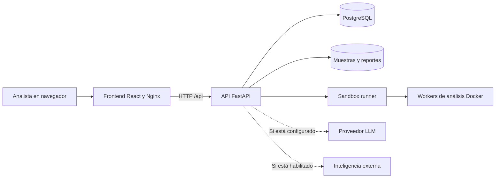

# ARGOS

ARGOS es un laboratorio de análisis de archivos sospechosos para analistas de ciberseguridad. Combina una consola React con una API que coordina herramientas de análisis, almacena investigaciones y genera informes con evidencia y limitaciones. Puede utilizar agentes CrewAI y un modelo LLM si están configurados.

El proyecto realiza principalmente análisis estático y, según la herramienta, emulación; sus resultados apoyan la investigación y no garantizan la detección de todas las amenazas.

## Contenido

- [Funciones principales](#funciones-principales)
- [Arquitectura](#arquitectura)
- [Tecnologías](#tecnologías)
- [Inicio con Docker](#inicio-con-docker)
- [Uso de la aplicación](#uso-de-la-aplicación)
- [Desarrollo y validación](#desarrollo-y-validación)
- [Configuración y seguridad](#configuración-y-seguridad)
- [Estructura y documentación](#estructura-y-documentación)
- [Problemas frecuentes](#problemas-frecuentes)

## Funciones principales

- Carga de muestras PDF, Office, JavaScript y binarios para su investigación.
- Configuración por investigación de espera de respuesta (`wait`), uso de LLM, CrewAI y privacidad estricta.
- Seguimiento de estado y eventos del análisis desde la interfaz.
- Consulta de muestras, artefactos relacionados, indicadores e informes JSON, Markdown y HTML.
- Consulta del estado del sandbox y de las herramientas registradas.

Las capacidades disponibles dependen de las imágenes, herramientas y servicios configurados en el backend. La búsqueda de indicadores consulta los registros devueltos por la API; no implica que se consulten servicios externos en cada búsqueda.


## Arquitectura



En la configuración local, Nginx sirve el frontend y redirige `/api/` a la API. El backend coordina las investigaciones y utiliza un runner para lanzar workers de análisis. PostgreSQL conserva metadatos y los volúmenes almacenan datos y reportes. Las integraciones externas son opcionales.

## Tecnologías

| Componente | Tecnología | Responsabilidad |
|---|---|---|
| Frontend | React, JavaScript, Vite y CSS | Interfaz y seguimiento de investigaciones |
| API | Python 3.12+, FastAPI y Pydantic | Endpoints, validación y coordinación |
| Persistencia | SQLAlchemy y PostgreSQL | Metadatos y resultados |
| Análisis | Herramientas especializadas en contenedores | Procesamiento de muestras por tipo |
| IA opcional | CrewAI y proveedor LLM configurable | Interpretación y coordinación de agentes |
| Infraestructura local | Docker Compose y Nginx | Servicios, aislamiento y proxy |

Las dependencias y versiones declaradas se encuentran en [backend/pyproject.toml](backend/pyproject.toml) y [frontend-argos/package.json](frontend-argos/package.json).

## Inicio con Docker

### Requisitos

- Docker Desktop o Docker Engine con Compose v2 en ejecución.
- PowerShell 5.1 o posterior para el script de inicio.
- Espacio para construir las imágenes de los workers; la guía del backend estima aproximadamente 3 GB de disco y 2 GB de memoria libres.

En un clon nuevo, comprueba primero si existe `backend/.env.docker.example`. El script de inicio la usa para crear `backend/.env.docker`, pero **la plantilla no está versionada actualmente**. Si no tienes esa plantilla, crea un archivo local mínimo desde la raíz del proyecto:

```powershell
$runnerToken = [guid]::NewGuid().ToString('N') + [guid]::NewGuid().ToString('N')
[System.IO.File]::WriteAllText((Join-Path (Get-Location) 'backend/.env.docker'), "RUNNER_SHARED_TOKEN=$runnerToken`n", [System.Text.UTF8Encoding]::new($false))
```

Este archivo es local y contiene una credencial interna; no lo publiques. Si ya existe, conserva tu configuración y omite el comando anterior. Para habilitar LLM y agentes, configura la clave y opciones del proveedor en ese archivo siguiendo la [guía del backend](backend/README.md).

Desde la raíz, inicia la pila completa:

```powershell
.\up.ps1
```

El script prepara el backend, construye las imágenes de workers si faltan e inicia frontend y API. La primera compilación puede tardar varios minutos. Para reconstruir las imágenes de análisis:

```powershell
.\up.ps1 -ForceBuild
```

| Servicio | Dirección local predeterminada |
|---|---|
| Interfaz | http://127.0.0.1:5173 |
| API y documentación interactiva | http://127.0.0.1:8000/docs |
| Salud de la API | http://127.0.0.1:8000/health |

Para consultar el estado, ver registros o detener los servicios:

```powershell
docker compose ps
docker compose logs -f api
docker compose down
```

`docker compose down` conserva los volúmenes salvo que se solicite explícitamente su eliminación. La topología de Compose documentada corresponde al entorno local; el despliegue en producción requiere definición y revisión adicionales.

## Uso de la aplicación

1. Abre la interfaz y selecciona un archivo en **Analizar una muestra**.
2. Ajusta las opciones de espera, LLM, CrewAI y privacidad disponibles para esa investigación.
3. Inicia el análisis y consulta el estado y los eventos en el detalle de la muestra.
4. Cuando exista un informe, selecciónalo en JSON, Markdown o HTML; también puedes descargarlo.
5. Usa **Indicadores** para buscar registros por valor y **Herramientas** para revisar el sandbox y los motores disponibles.

La interfaz crea primero la investigación y después solicita su inicio con `wait=true` o `wait=false`. Consulta los eventos por separado mientras avanza el análisis. La disponibilidad de CrewAI depende de la configuración del backend y del proveedor LLM.

## Desarrollo y validación

Con la API disponible, ejecuta el frontend de forma independiente:

```powershell
cd frontend-argos
npm ci
npm run dev
```

Vite muestra la dirección efectiva en la terminal. El frontend utiliza por defecto `http://127.0.0.1:8000`; puedes definir `VITE_API_URL` en un archivo local `.env.local` si necesitas otra dirección. Consulta la [guía del frontend](frontend-argos/README.md) para configuración y CORS.

Validaciones del frontend desde `frontend-argos/`:

```powershell
npm run lint
npm run build
```

La compilación genera `frontend-argos/dist/`. El frontend no declara scripts de pruebas unitarias o E2E. El backend incluye pruebas con pytest; consulta su [guía de pruebas](backend/README.md#13-tests-y-calidad) y requisitos antes de ejecutarlas. Python no es necesario en el host para usar la pila Docker.

## Configuración y seguridad

| Variable | Ubicación o uso | Propósito |
|---|---|---|
| `RUNNER_SHARED_TOKEN` | `backend/.env.docker` | Autentica la comunicación interna con el runner. |
| `DEEPSEEK_API_KEY` | `backend/.env.docker` | Clave opcional para el proveedor LLM. |
| `CREW_ENABLED`, `ENABLE_LLM`, `STRICT_PRIVACY` | `backend/.env.docker` | Valores de configuración del análisis. |
| `API_KEY` | `backend/.env.docker` | Clave opcional exigida por la API. |
| `VITE_API_URL` | Entorno de compilación del frontend | Base de la API; Compose usa `/api`. |
| `VITE_API_KEY` | Entorno de compilación del frontend | Cabecera opcional `X-API-Key`. |
| `ARGOS_FRONTEND_PORT` | Entorno de Compose de la raíz | Puerto local del frontend; por defecto 5173. |

Las variables `VITE_` se incorporan al código entregado al navegador. Por ello, una clave usada en `VITE_API_KEY` queda visible para quien acceda a la interfaz y no debe tratarse como secreto. Si se cambia una variable de compilación, reconstruye la imagen del frontend. El Compose local publica la API y el frontend en `127.0.0.1` de forma predeterminada.

La API admite una clave compartida opcional; no se identifica un sistema de usuarios, sesiones o roles en el frontend. El runner tiene acceso al socket de Docker, por lo que debe tratarse como un componente privilegiado. No versiones archivos `.env`, muestras sensibles ni registros que puedan contener datos de investigaciones.

## Estructura y documentación

```text
ARGOS/
├── backend/                 API, pipeline, runner, workers y pruebas
├── frontend-argos/          Interfaz React y configuración Nginx
├── docker-compose.yml       Composición global de servicios
├── up.ps1                   Inicio de la pila en PowerShell
└── README.md                Guía general
```

- [Documentación del backend](backend/README.md): herramientas, configuración, API, aislamiento y operación. Algunas secciones describen el backend de forma independiente; el proyecto completo sí incluye frontend.
- [Documentación del frontend](frontend-argos/README.md): arquitectura React, flujos, variables y compilación.
- [Arquitectura del backend](backend/docs/arquitectura.md) y [seguridad del backend](backend/docs/seguridad.md).
- [Contexto de producto](frontend-argos/PRODUCT.md) y [sistema visual](frontend-argos/DESIGN.md).

## Problemas frecuentes

| Situación | Qué revisar |
|---|---|
| El script no encuentra `.env.docker.example` | Crea `backend/.env.docker` con el procedimiento anterior; la plantilla no está versionada. |
| La interfaz no conecta con la API | Comprueba `docker compose ps`, los logs de `api` y `/health`; en Vite revisa `VITE_API_URL` y CORS. |
| Faltan imágenes de análisis | Ejecuta `.\up.ps1 -ForceBuild` y revisa los mensajes de construcción. |
| No se activan los agentes | Revisa la configuración LLM y CrewAI en el backend y la opción seleccionada en la investigación. |
| Un puerto está ocupado | Libera el puerto o configura el puerto correspondiente; el frontend usa `ARGOS_FRONTEND_PORT`. |
| Un cambio de configuración del frontend no aparece en Docker | Reconstruye la imagen para incorporar los valores `VITE_`. |
