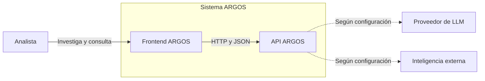
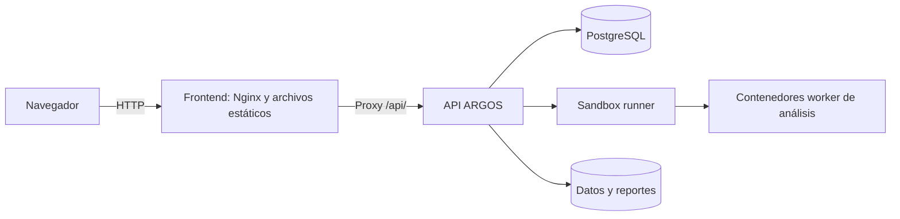
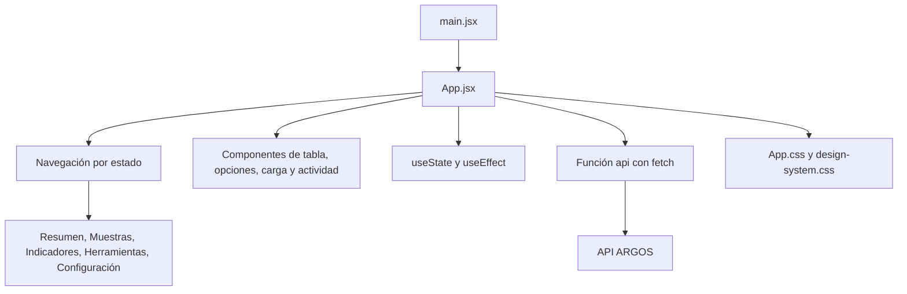
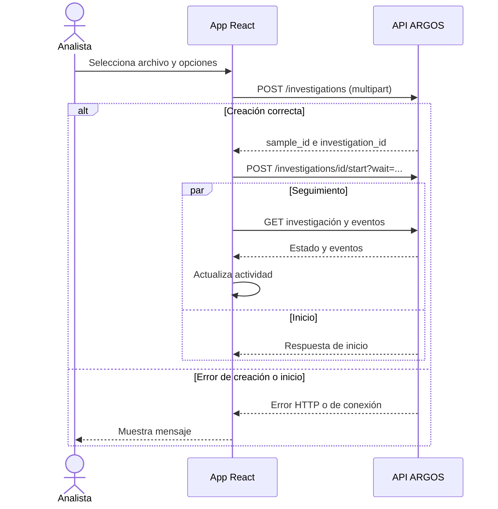
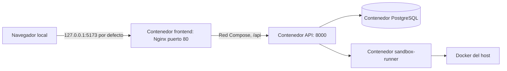
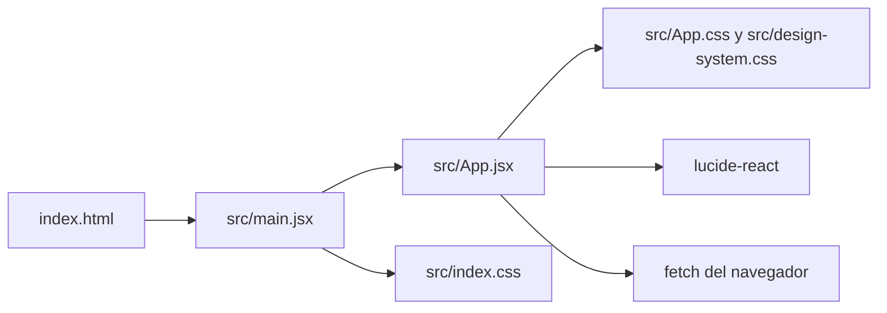

# ARGOS · Frontend

Consola web para analistas de ciberseguridad que investigan archivos sospechosos. Permite iniciar investigaciones, seguir su actividad, consultar evidencias e informes y buscar indicadores registrados por el backend. Su objetivo es apoyar decisiones explicables; el análisis y la persistencia corresponden a la API de ARGOS.

## Índice

- [Tecnologías](#tecnologías)
- [Arquitectura](#arquitectura)
- [Instalación y ejecución](#instalación-y-ejecución)
- [Flujos y API](#flujos-y-api)
- [Seguridad](#seguridad)
- [Despliegue y validación](#despliegue-y-validación)
- [Estructura](#estructura)
- [Resolución de problemas](#resolución-de-problemas)

## Tecnologías

Las versiones son rangos declarados en `package.json`; `package-lock.json` fija la instalación reproducible.

| Tecnología | Versión declarada | Uso |
|---|---|---|
| React / React DOM | ^19.3.1 | Interfaz y renderizado |
| JavaScript / JSX | ES modules; sin versión fijada | Implementación |
| Vite | ^8.3.6 | Desarrollo y compilación |
| @vitejs/plugin-react | ^6.1.2 | Integración de React con Vite |
| Tailwind CSS / plugin Vite | ^4.3.5 | Integración de estilos; la interfaz usa CSS propio |
| lucide-react | ^1.73.0 | Iconos |
| Fetch del navegador | Integrado | Cliente HTTP |
| Oxlint | ^1.90.0 | Análisis estático |
| Impeccable | ^4.9.2 | Herramienta de revisión de diseño |

`react-router-dom` ^7.18.5 está declarado, pero la navegación actual no lo utiliza. No hay librería de componentes UI ni framework de pruebas configurados en los scripts.

## Arquitectura

### Contexto



El navegador interactúa con la API. Las integraciones externas dependen de la configuración del backend; no se identifica un proveedor de autenticación en el frontend.

### Contenedores



Compose define Nginx, API, PostgreSQL y runner; las imágenes de workers se construyen bajo el perfil `build`. Los volúmenes conservan datos y reportes. La ejecución de workers depende del runner y Docker.

### Interior del frontend



No hay rutas URL individuales: `page` y `selected` controlan las vistas en memoria. `api()` centraliza conexión, cabecera opcional y errores HTTP. El estado se mantiene en React, sin almacén global.

### Secuencia de investigación



El flujo permite consultar eventos mientras la solicitud de inicio espera. El seguimiento vuelve a intentar si falla la consulta.

### Despliegue local



Esta topología está definida para Compose local. No se ha identificado un despliegue productivo ni infraestructura cloud en la configuración del frontend.

### Dependencias de módulos



Los componentes y el cliente HTTP residen actualmente en `App.jsx`; no existe un directorio independiente de servicios o rutas.

## Instalación y ejecución

### Requisitos

- Git, Node.js y npm. El Dockerfile utiliza Node 22; no se ha identificado `.nvmrc` ni `engines` propios que fijen una versión local.
- Backend ARGOS operativo para las funciones de investigación. Para la pila completa: Docker con Compose v2 y configuración descrita en [backend/README.md](../backend/README.md).

No hay remoto Git configurado en el repositorio inspeccionado. Sustituye el marcador por la URL facilitada por el equipo:

```sh
git clone <URL_DEL_REPOSITORIO>
cd ARGOS/frontend-argos
npm ci
npm run dev
```

Vite muestra la URL y puerto efectivos en la terminal; habitualmente usa `http://localhost:5173`, si está libre. El servidor por defecto de la API es `http://127.0.0.1:8000`. El navegador debe poder alcanzarlo y el backend debe permitir el origen mediante CORS. Para cambiar la conexión, crea `frontend-argos/.env.local` con las variables necesarias y reinicia Vite.

| Variable | Propósito | Obligatoria | Ejemplo seguro |
|---|---|---|---|
| `VITE_API_URL` | URL base de la API; por defecto `http://127.0.0.1:8000` | No | `http://127.0.0.1:8000` |
| `VITE_API_KEY` | Valor opcional de la cabecera `X-API-Key` | Solo si la API exige clave | `clave-de-desarrollo` |

Las variables `VITE_` quedan incorporadas al código distribuido al navegador: no proporcionan almacenamiento secreto. No incluyas credenciales sensibles en el frontend. En Docker, la URL se fija a `/api` durante la compilación; cambiar una variable de compilación exige reconstruir la imagen.

### Pila Docker local

Desde la raíz del repositorio, prepara `backend/.env.docker` siguiendo las instrucciones del [backend](../backend/README.md), incluyendo `RUNNER_SHARED_TOKEN`, y construye las imágenes de workers según esa guía. Después:

```sh
docker compose up -d --build
docker compose ps
```

Abre `http://127.0.0.1:5173`, salvo que se haya cambiado `ARGOS_FRONTEND_PORT`. Compose espera a que la API esté saludable antes de iniciar el frontend. Consulta la guía del backend para sus variables, imágenes y requisitos de análisis.

## Flujos y API

- Al iniciar, se consultan salud, estadísticas y muestras cada 10 segundos; las opciones predeterminadas se obtienen de la API.
- La carga crea una investigación con archivo y opciones LLM, CrewAI y privacidad; después la inicia con el valor seleccionado de `wait`. La muestra seleccionada se actualiza cada 3 segundos y los eventos se consultan con cursor normalmente cada 2 segundos hasta finalizar.
- El detalle muestra estado, hash, actividad, artefactos hijos e informes JSON, Markdown o HTML. El informe HTML se muestra en un `iframe` con `sandbox`.
- Indicadores consulta `/indicators-of-compromise?value=...`; la búsqueda presenta los registros devueltos por la API. Herramientas consulta `/analysis-tools` y `/sandbox-status`.
- Configuración permite probar `/llm/connection-test`. Los errores de conexión y HTTP se muestran en la interfaz; el sondeo de eventos reintenta tras errores.

La función `api()` consulta además `/health`, `/analysis-statistics`, `/malware-samples`, `/investigation-options`, los detalles y eventos de `/investigations/{id}`, y los informes bajo `/malware-samples/{id}/analysis-report`. Los contratos completos pertenecen al backend.

## Seguridad

El frontend puede enviar una clave estática mediante `X-API-Key`; no se observa inicio de sesión, gestión de tokens o sesiones, roles ni protección de rutas en React. La autorización efectiva depende del backend y de su configuración. Las políticas CORS son responsabilidad de la API cuando se accede directamente desde Vite. El `iframe` del informe HTML utiliza `sandbox` sin permisos adicionales.

Para producción, evaluar autenticación y autorización del lado servidor, gestión de secretos y configuración CORS según el entorno. La presencia de una clave en el bundle no constituye una credencial privada.

## Despliegue y validación

```sh
npm run lint
npm run build
npm run preview
```

`build` genera `dist/`; `preview` sirve la compilación localmente. El Dockerfile compila con Node y copia `dist/` a Nginx; Nginx sirve los archivos y redirige `/api/` a la API. Los argumentos `VITE_API_URL` y `VITE_API_KEY` se aplican al construir. Compose publica el frontend solo en la interfaz local por defecto. La API, PostgreSQL y runner definen comprobaciones de salud; no hay una comprobación propia del frontend en Compose.

No se identificaron scripts para pruebas unitarias, integración, E2E, formateo o comprobación de tipos, ni un pipeline de CI/CD del frontend. La publicación y ambientes productivos están pendientes de confirmar. `npm run impeccable` ejecuta la herramienta de diseño instalada.

## Estructura

```text
frontend-argos/
├── src/
│   ├── main.jsx             Punto de entrada
│   ├── App.jsx              Vistas, estado y cliente HTTP
│   ├── index.css            Estilos globales
│   ├── App.css              Estilos de componentes
│   └── design-system.css    Tokens y ajustes visuales
├── public/                  Recursos estáticos
├── index.html               Documento de entrada
├── vite.config.js           Plugins de Vite
├── Dockerfile               Compilación y servidor Nginx
├── nginx.conf               Archivos estáticos y proxy
├── package.json             Dependencias y scripts
├── package-lock.json        Resolución reproducible
├── PRODUCT.md               Contexto de producto
└── DESIGN.md                Dirección visual
```

## Resolución de problemas

| Problema | Causa probable | Acción |
|---|---|---|
| La interfaz indica que no conecta con la API | Backend detenido, URL incorrecta o CORS | Comprueba `/health`, `VITE_API_URL` y el origen permitido por la API. |
| Puerto de desarrollo ocupado | Otro proceso lo utiliza | Usa la URL que muestra Vite o libera el puerto. |
| Compose exige `RUNNER_SHARED_TOKEN` | Falta configuración del runner | Sigue la preparación de `backend/.env.docker` en la guía del backend. |
| Cambiar `VITE_API_URL` no afecta la imagen existente | La variable se incorporó durante la compilación | Reconstruye el frontend con los argumentos deseados. |
| El análisis no dispone de herramientas | Las imágenes de workers no se han construido o el runner no está disponible | Revisa los pasos de imágenes y diagnóstico del backend. |
